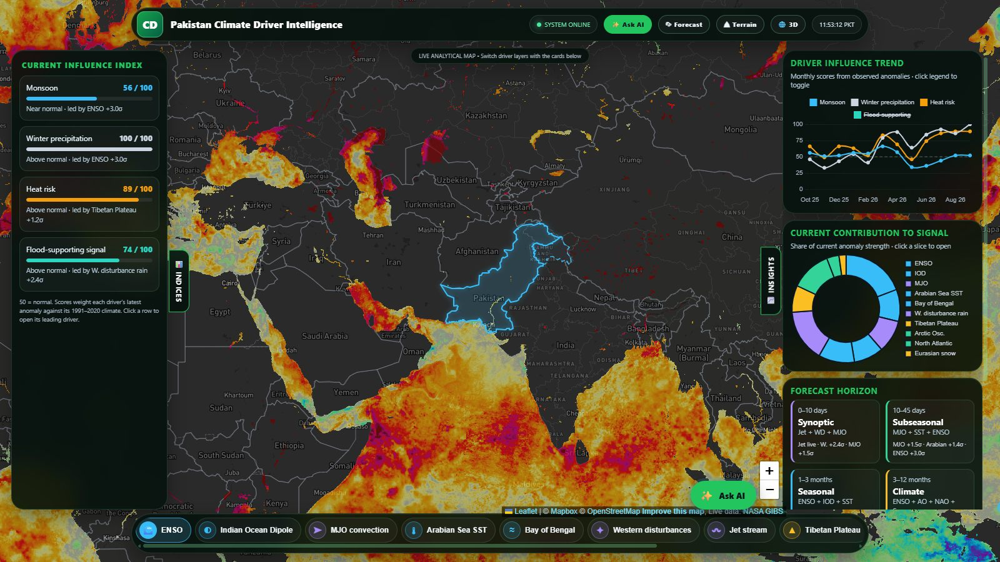
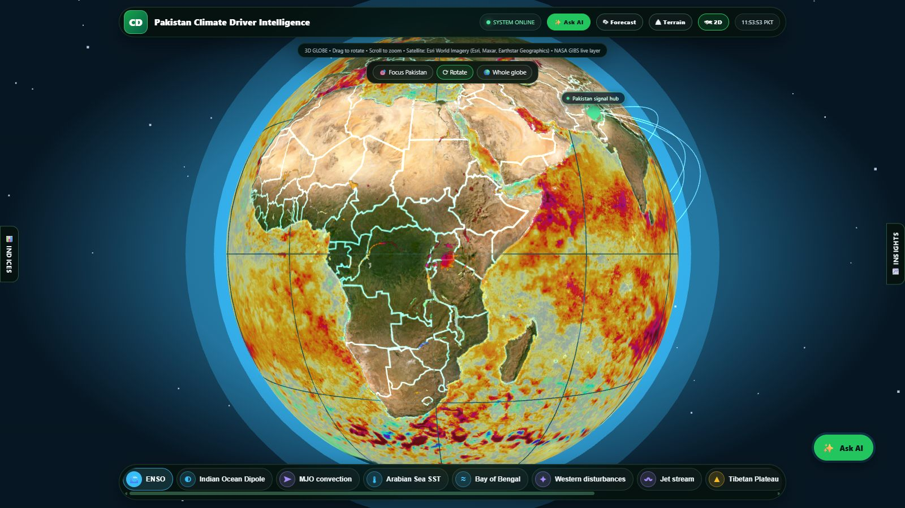
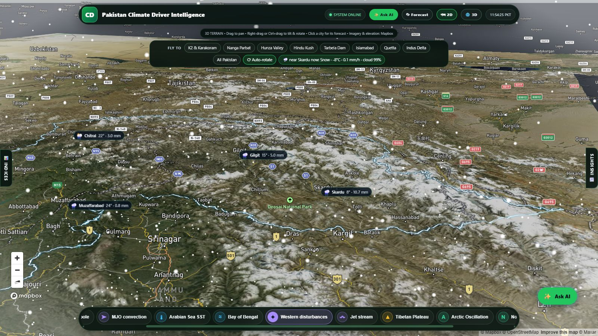
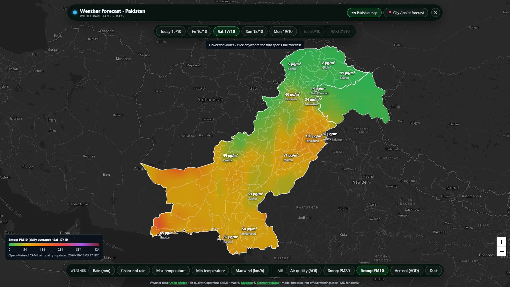
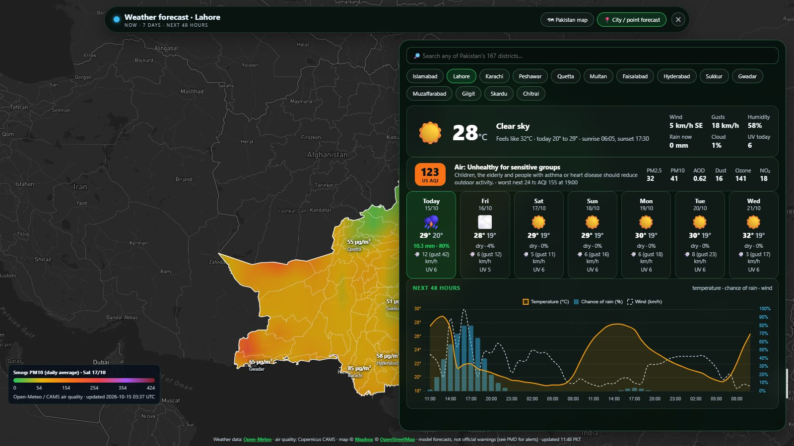
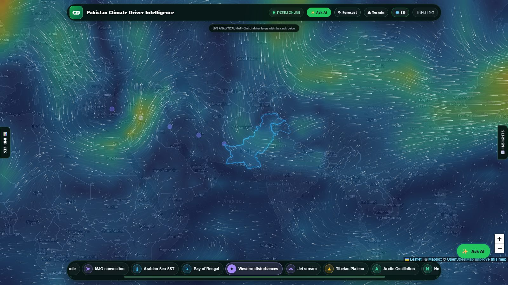
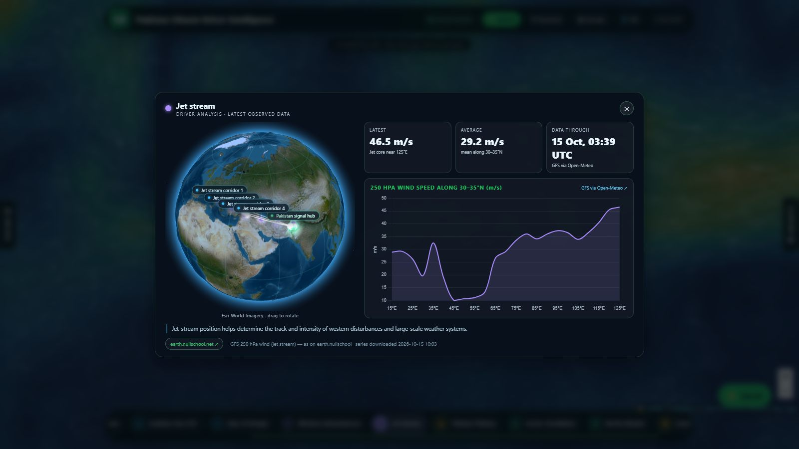
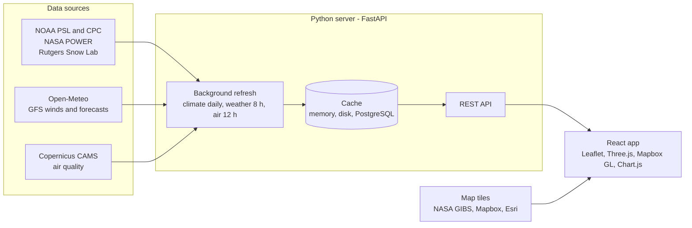

<div align="center">

# 🌐 Pakistan Climate Intelligence

**A live dashboard that tracks the global climate drivers behind Pakistan's weather and turns them into an early-warning view, with 7-day weather and air-quality forecasts down to district level.**

[](https://github.com/mahnoor114/pak-climate-portal/actions/workflows/ci-cd.yml)




</div>

## Overview

Pakistan's monsoon, winter rain and snow, heat waves and floods are driven by climate signals that start far from its borders, such as El Niño in the Pacific, the Indian Ocean Dipole and the jet stream. This portal follows eleven of these drivers using the latest observed data and combines them into four influence scores for Pakistan. Live weather and air-quality forecasts sit alongside the scores, so you can see both the drivers and their likely effect on the ground.

It runs as one small Python server. The data is refreshed in the background and cached in memory, on disk and optionally in PostgreSQL, so pages load instantly and never wait for an outside service.

## Features

| | |
|---|---|
| **Eleven climate drivers** | ENSO, Indian Ocean Dipole, MJO, Arabian Sea and Bay of Bengal SST, western disturbances, jet stream, Tibetan Plateau, Arctic and North Atlantic Oscillations, Eurasian snow. Each one has its region on the map and a live satellite or model layer. |
| **Influence scores** | Monsoon, winter precipitation, heat risk and flood-supporting signal, each 0–100 (50 = normal). They are built from each driver's standardized anomaly against its 1991–2020 climate, with a 12-month trend and each driver's share of the current signal. |
| **Live layers** | NASA GIBS satellite tiles (sea-surface temperature and anomaly, precipitation, snow, vegetation, true colour) and animated GFS upper-level winds at 250 and 500 hPa, drawn like earth.nullschool. |
| **Three map views** | 2D analytical map, a 3D satellite globe with arcs from each driver to Pakistan, and 3D terrain of Pakistan's mountains with live rain, snow, sky and sun that follow the forecast where the camera looks. |
| **Forecast map** | 7-day rain, chance of rain, temperature and wind, plus 5-day AQI, PM2.5, PM10, aerosol and dust for all of Pakistan, clipped to the official boundary. Hover for district averages across all 167 districts; click anywhere for that spot's full forecast. |
| **City and point forecasts** | Current conditions, a 7-day outlook, a 48-hour chart and air quality with health advice, for 14 cities, any district or any clicked point. |
| **Driver analysis cards** | The latest value, its change and phase (El Niño / La Niña, positive / negative IOD…), the observed series chart and its data source. |
| **AI assistant** | Ask about the portal in English or Urdu. Claude or Grok answers from the portal's own data and from what is on your screen. It works through the server with an API key, or free through Puter without one. |

## Screenshots

| 3D globe | 3D terrain with live weather |
|---|---|
|  |  |
| **Forecast map: PM10 by district** | **City forecast over the map** |
|  |  |
| **Upper-level winds (500 hPa)** | **Driver analysis: jet stream** |
|  |  |

## How it works



- **Refresh, then serve.** Background threads download each dataset on a schedule. Every request is answered from the cache, and when an outside service is down the last good copy is shown, marked as stale.
- **One call for many viewers.** Simultaneous requests for the same city or point share a single upstream call, and the results are reused for 30–60 minutes.
- **History.** With PostgreSQL configured, every refresh is stored with its fetch time (schema `climate_portal`). The database also restores the cache after a restart.

## Quick start

**Requirements:** Python 3.12+ and Node.js 20+ (Node is only needed to build the frontend).

```bash
git clone https://github.com/mahnoor114/pak-climate-portal.git
cd pak-climate-portal

# 1. Server packages
pip install -r requirements.txt

# 2. Build the frontend into dist/
cd frontend && npm ci && npm run build && cd ..

# 3. Run
python portal_api.py
```

Open **http://localhost:8000**. The first start downloads the climate series and forecast grids, which takes about a minute. Interactive API documentation is at **http://localhost:8000/docs**.

On Windows, `Start portal.bat` does the same and opens the browser. `Install autostart.bat` keeps the portal running in the background from login, restarting it if it stops. `Install daily refresh.bat` wakes the PC from sleep every day at 10:00 (when it is plugged in), so the data is refreshed every day even when nobody is using the PC.

### Configuration

All settings are optional environment variables.

| Variable | Purpose |
|---|---|
| `ANTHROPIC_API_KEY` / `XAI_API_KEY` | AI assistant through the server (Claude / Grok). Without them, the assistant runs free through Puter. |
| `PORTAL_PORT` | Port (default `8000`) |
| `PORTAL_HOST` | Bind address (default `0.0.0.0`, reachable from the network; `127.0.0.1` for this PC only) |
| `PORTAL_DB_PASSWORD` | Turns on PostgreSQL storage |
| `PORTAL_DB_HOST` / `PORTAL_DB_PORT` / `PORTAL_DB_USER` / `PORTAL_DB_NAME` | Database connection (defaults `localhost` / `5432` / `postgres`) |

## API

| Endpoint | Returns |
|---|---|
| `GET /api/indices` | Monthly climate-driver series with anomalies (ENSO, IOD, AO, NAO, snow, SST, MJO…) |
| `GET /api/wind` | Upper-level wind (250 / 500 hPa), global grid plus a finer grid over the western-disturbance corridor |
| `GET /api/pakforecast` | 7-day forecast grid for all of Pakistan plus 14 cities |
| `GET /api/forecast?lat=&lon=` | 7-day and hourly forecast for one point |
| `GET /api/aqmap` | 5-day AQI, PM2.5, PM10, AOD and dust grid for Pakistan |
| `GET /api/airquality?lat=&lon=` | Current air quality and the next 48 h for one point |
| `POST /api/chat` | AI assistant answer, streamed as server-sent events |

## Development

```bash
# Terminal 1: the server (data and API)
python portal_api.py

# Terminal 2: the frontend with hot reload on http://localhost:5173 (forwards /api and /lib to :8000)
cd frontend && npm run dev
```

```
frontend/            React app (Vite)
  src/components/    Map, 3D globe, terrain, panels, forecast window, driver card, AI panel
  src/core/          Shared logic: wind field, tiles, weather variables, scores, constants
lib/                 Data files loaded at runtime (boundaries, districts, climate series)
portal_api.py        FastAPI app: routes and API docs
portal_server.py     Data refresh, caching, AI assistant; also a standard-library fallback server
portal_db.py         PostgreSQL storage
update_data.py       Downloads the climate-driver series
tests/               Server tests
```

Run the tests with `pip install -r requirements-dev.txt` and then `python -m pytest`. They need a built `dist/`.

## CI/CD

[`.github/workflows/ci-cd.yml`](.github/workflows/ci-cd.yml)

1. **Build frontend:** a clean `npm ci` and production build on every push and pull request.
2. **Test server:** compiles every Python file and checks that the server serves the built app, its assets, the data files and the API, and never serves secrets or files outside the portal.
3. **Deploy:** on pushes to `main`, a self-hosted runner on the portal machine updates the portal to the new commit, installs the build, restarts it and checks that it serves the new version. It refuses to overwrite unpushed or uncommitted work ([`deploy_portal.ps1`](deploy_portal.ps1)).

## Data sources and credits

| Data | Source |
|---|---|
| Niño 3.4, IOD, AO, NAO, MJO | [NOAA PSL](https://psl.noaa.gov/) and [NOAA CPC](https://www.cpc.ncep.noaa.gov/) |
| Sea and land temperature, precipitation | [NASA POWER](https://power.larc.nasa.gov/) (MERRA-2) |
| Eurasian snow cover | [Rutgers Global Snow Lab](https://climate.rutgers.edu/snowcover/) |
| Weather forecasts, GFS winds | [Open-Meteo](https://open-meteo.com/) |
| Air quality | [Copernicus CAMS](https://atmosphere.copernicus.eu/) via Open-Meteo |
| Live satellite layers | [NASA GIBS](https://gibs.earthdata.nasa.gov/) |
| Base maps, 3D terrain | [Mapbox](https://www.mapbox.com/), © [OpenStreetMap](https://www.openstreetmap.org/copyright) contributors, [Esri World Imagery](https://www.esri.com/) |
| Country borders | [Natural Earth](https://www.naturalearthdata.com/); Pakistan national and district boundaries from official shapefiles |

> **Disclaimer.** The influence scores are a transparent research heuristic, and the forecasts are model output. Neither is an official warning. For alerts, see the [Pakistan Meteorological Department](https://www.pmd.gov.pk/).
